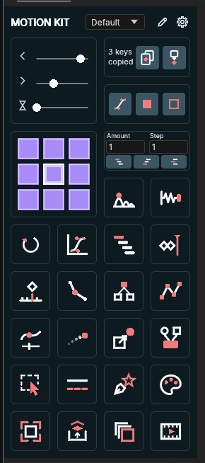
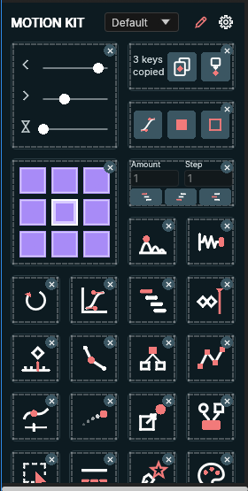
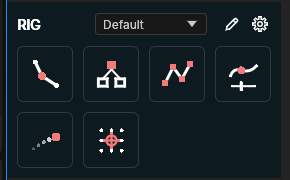

# Motion Kit

24 motion design tools and 5 inline widgets for EffectCraft, in one dockable panel. Its view list switches between the combined view (every widget and tool), one category at a time, and a compact menu. You can rearrange and restyle every view.

  

## Install

In EffectCraft, use File ▸ Scripts ▸ Install ScriptUI Panel… for `dist/Motion Kit.jsx`, then open it from the bottom of the Window menu. That one entry is all you need. The view list in its header picks what it shows, and it remembers the choice:

- **Combined:** the widgets, then every tool;
- **Animate**, **Rig**, **Shapes**, **Comp:** one category each (named after the layout's panels 1–4);
- **Menu:** every tool from two dropdowns.

To dock several views at once, also install the optional single panels in `dist/extra/`: `Motion Kit 1.jsx` to `Motion Kit 4.jsx` and `Motion Kit Menu.jsx`. Each adds its own Window menu entry. Once EffectCraft supports submenus in the Window menu, put them in a "Motion Kit" subfolder of the ScriptUI Panels folder; until then, install them at the top level like `Motion Kit.jsx`.

All panels share one layout, so a change made in one shows up in the others. `dist/motionkit-lib.jsx` has no UI; the tests use it.

## Use

- **Run:** click a button to run its tool on the active comp's selection. Each run is one undo step. Buttons show only their icon; hover for the tool's name and what it does.
- **Options:** Shift-click (or right-click) a button for its options. Options are remembered, and a plain click uses them.
- **Rearrange:** click the pencil in a panel's header for edit mode. Every cell then gets a dashed outline and a ✕ that removes it, a trailing **+** cell adds tools and widgets the panel doesn't have yet, and dragging a cell reorders it. Click the pencil again when you're done. Out of edit mode, dragging never moves a cell, so a slider drag stays a slider drag. To move buttons between panels, use the ⚙ button's Layout & Style dialog, because ScriptUI can't drag between windows.
- **Views:** the view list (under the title in `Motion Kit.jsx`) switches the panel between the combined view, the four categories and the menu.
- **Layouts:** the layout list in the header switches every panel to another named layout.
- **Command box:** type part of a tool's name in panel 1's command box and press Enter.

Controls a tool adds are Expression Controls named "Tool – Setting" (for example "Bounce – Amplitude"), so you can change them later in Effect Controls.

## Widgets

Widgets are bigger cells with their own controls. The Motion Kit panel starts with all five, and any panel can add them from the **+** cell or Layout & Style. Each action is one undo step, and the widgets remember their values.

| Widget | Size | What it does |
|---|---|---|
| Ease | 2 × 2 | Three sliders: **Ease In** and **Ease Out** are the incoming and outgoing influence (0.1–100 %), **Speed** is the speed at the key. Releasing a slider applies all three to the selected keyframes through Ease Keyframes. Click a slider's icon to reset it. Shift-click opens the Ease Keyframes curve editor. |
| Key Copy/Paste | 2 × 1 | **Copy** keeps the selected keyframes of the selected properties: values, eases, interpolation, spatial tangents and timing. **Paste** puts them at the playhead on the selected properties: the first copied property onto the first selected one, and so on, or one copied property onto all of them. Shift-click Paste pastes only the easing onto the selected keyframes. |
| Interpolation | 2 × 1 | Sets the selected keyframes to Bezier, Hold or Linear on both sides. A key switched back to Bezier gets its ease back. |
| Anchor | 2 × 2 | Click a point of the 3 × 3 grid to move the anchor of the selected layers or shape groups there without moving them. The last point used is highlighted. Shift-click opens Move Anchor Point's options (Include masks). |
| Sequencer | 2 × 1 | **Amount** and **Step** fields, then top-to-bottom, bottom-to-top and from-the-centre buttons. It staggers the selected keyframes when some are selected on the selected layers, otherwise the layers. Shift-click opens the full Sequencer options (random order, curves). |

Two of these are Motion Kit's own definitions:

- **Speed** is a percentage of the segment's average speed: 0 % stops at the key, 100 % keeps the average speed, up to 200 %. Ease Keyframes caps it at 100 / influence times the average, so an ease can't overshoot.
- **Amount and Step:** item *k* of the order moves Amount × floor(*k* / Step) frames. Amount is frames per step (negative or fractional too; results round to whole frames), and Step is how many items share each step. From the centre, *k* is the distance from the middle, so the middle item (or the two middle items) keeps its time and both sides move alike.

## Tools

The Motion Kit panel has every tool except Ease Copy and Move Anchor Point, which the Key Copy/Paste and Anchor widgets replace there. Their buttons still work in the other panels and saved layouts.

**Animate**

| Tool | What it does |
|---|---|
| Bounce | After the last keyframe, the value bounces like a ball. Controls: Amplitude, Gravity, Max Jumps and Jump In/Out (also before the first key). |
| Elastic | A decaying spring overshoot after the last keyframe. Controls: Amplitude, Frequency, Decay and Jump In/Out. |
| Loop In/Out | Adds a cycle, pingpong, offset or continue loop before, after or on both sides of the keyframes. |
| Ease Keyframes | Sets the ease on the selected keys from a draggable speed-curve editor or presets. |
| Ease Copy | Copies a key's value, ease, interpolation and expression, then pastes your choice of them onto the selected keys. |
| Sequencer | Staggers layers' start times, or the selected keyframes. Order: top to bottom, bottom to top, from the centre, selection or random. Step in frames, items per step, with an ease curve. |
| Clone Keys to Playhead | Copies the selected keys to the current time, keeping their spacing. |
| Fix Keys Time | Snaps keyframes onto whole frames. |

**Rig**

| Tool | What it does |
|---|---|
| Limb | A two-segment IK limb: root and controller nulls, a joint null, and a stroked path. Controls cover length, joint position, bend direction and curvature, auto-flip, ground, stretch and control style. |
| Add Parent Null | A null at the centre of the selected layers that becomes their parent, without moving them. It can also make one null per layer. |
| Nulls ↔ Points | A null on every vertex of a shape or mask path. Either the path follows the nulls, or the nulls follow the path. |
| Slider to Path | Puts layers on a path, each with a Path Progress slider, optionally rotating along it. |
| Position Trace | A live trail of a layer's motion, with frames, offset, smoothing, detail and taper controls. |
| Move Anchor Point | Moves anchors to a point on a 3 × 3 grid without moving the layers, also per keyframe and for shape groups. |

**Shapes**

| Tool | What it does |
|---|---|
| Extract Shapes | Puts each shape group on its own layer. |
| Merge Shapes | Merges shape layers into one, with one group per layer. |
| Selector | Selects every path, fill, stroke, group, transform, mask or other chosen property type inside the selected layers. |
| Toggle Stroke Style | Cycles strokes through solid, round, dashed and dotted. |
| Shapes from Vector | Converts SVG, PDF or Illustrator layers to shape layers. |
| Collect Colors | Collects the colours used in the selected layers into a palette layer and a null of Color Controls, merging similar colours. |

**Comp**

| Tool | What it does |
|---|---|
| Crop Comp | Precomposes the selected layers into a comp cropped to their bounds over time, with optional padding. |
| Unprecomp | Moves a precomp's layers into the parent comp, under a null that carries the precomp's transform and timing. |
| Duplicate Comp | Duplicates comps, optionally deep through nested precomps, and rewrites `comp("…")` references in expressions. |
| GIF Export | Renders comps to looping or one-shot GIFs, with scale and frame rate options. |

## Layouts and styling

Every panel starts with the same dark theme: a dark blue-green background, cells outlined with rounded corners, white line icons with coral accents, and icon-only buttons. Panels are laid out to their content: the grid is as wide as the columns it uses, and the header is as wide as the grid.

The ⚙ button opens Layout & Style, which has five tabs:

- **Buttons:** all five panels side by side. Drag buttons within and between them, add tools and widgets, remove buttons, and rename panels.
- **Style:** per panel:
  - cell size, spacing and columns;
  - panel, button and border colours, the icon and text colour, the accent colour and the corner radius;
  - whether buttons show the icon (the default), the name, or both;
  - whether the title row and the command box are shown.
- **Button:** a button's own name, visibility and colours.
- **Layouts:** named layouts. Switch, add, duplicate, rename, delete or reset them, and save them to a `.json` file or load one, replacing or merging.
- **Library:** your own buttons. An expression button applies an expression to the selected properties. A script button runs inline code or a linked `.jsx` file. Each can use a built-in icon or a PNG.

Saving and loading layout files needs Preferences ▸ Scripting & Expressions ▸ Allow Scripts to Write Files.

Layouts saved by Motion Kit 0.1 had four panels. They load with the Motion Kit panel added in its default content, and every style value still at the old default (such as the icon-and-name buttons) takes the new default. Values you changed are kept.

## Limits in EffectCraft

- **Columns are a setting.** EffectCraft doesn't tell scripts how wide a docked panel is, so set **Columns** in Style to fit your dock.
- **Help tips need custom-drawn buttons.** EffectCraft shows a help tip for a custom-drawn control but not for a custom-drawn group, so every button and every widget control is a drawn `iconbutton`.
- **Bold is drawn twice.** EffectCraft draws every script font as regular, so the panel title is drawn twice, 0.6 px apart.
- **No join style.** ScriptUI pens have no round joins, so icons draw a dot on every corner.
- **Every event redraws the panel.** EffectCraft re-runs a script panel's drawing, lays it out and serialises it after every event the script receives. So Motion Kit listens to pointer movement only during a drag, has no hover highlight (help tips show what's under the pointer), and checks for changes made in other panels every 3 seconds and on every click.
- **Colours are pre-corrected.** EffectCraft 0.16 and earlier draw script colours too bright ([storytold/effectcraft#2272](https://github.com/storytold/effectcraft/pull/2272)), so Motion Kit corrects them when it runs in EffectCraft.
- **Deep duplicate needs EffectCraft 0.16 or later.** Duplicate Comp's Deep option needs `replaceSource`. On older versions it makes a plain duplicate and says so.
- **Some tools overwrite the clipboard.** Unprecomp and Merge Shapes copy through EffectCraft's clipboard.
- **GIF Export can't pick a folder.** Scripts can't open a folder picker or find the Desktop, so type an output folder, or GIFs go to the project folder or EffectCraft's default.

## Develop

```sh
python3 build.py              # src/ -> dist/
python3 build.py --check      # fails when dist/ is out of date
tests/run_all.sh              # 31 headless test files in effectcraft-cli, and the build checks
```

The tests run every tool through its API, check the results numerically, and render frames inside EffectCraft to confirm that tools which shouldn't move anything don't. The panel and widget tests click, drag and Shift-click through EffectCraft's own ScriptUI mouse routing. [CONTRIBUTING-TOOLS.md](CONTRIBUTING-TOOLS.md) explains how to add a tool.

Motion Kit is an independent project, written from scratch for EffectCraft. Its code, expressions and icons are original. Licensed MIT OR Apache-2.0.
