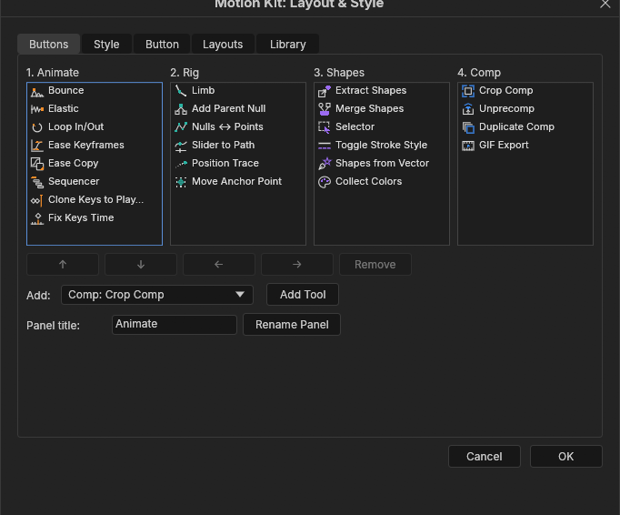

# Motion Kit

24 motion design tools for EffectCraft, in four dockable ScriptUI panels you can rearrange and restyle, plus a compact menu panel.

 

## Install

In EffectCraft, use File ▸ Scripts ▸ Install ScriptUI Panel… for each of these files in `dist/`:

- `Motion Kit 1.jsx` (Animate)
- `Motion Kit 2.jsx` (Rig)
- `Motion Kit 3.jsx` (Shapes)
- `Motion Kit 4.jsx` (Comp)
- `Motion Kit Menu.jsx` (every tool from two dropdowns)

Open them from the bottom of the Window menu. Install only the ones you want. They share one layout, so a change made in one panel shows up in the others. `dist/motionkit-lib.jsx` has no UI; the tests use it.

## Use

- **Run:** click a button to run its tool on the active comp's selection. Each run is one undo step.
- **Options:** Shift-click (or right-click) a button for its options. Options are remembered, and a plain click uses them.
- **Rearrange:** drag a button to reorder it within its panel. To move buttons between panels, use the ⚙ button's Layout & Style dialog, because ScriptUI can't drag between windows.
- **Command box:** type part of a tool's name in panel 1's command box and press Enter.

Controls a tool adds are Expression Controls named "Tool – Setting" (for example "Bounce – Amplitude"), so you can change them later in Effect Controls.

## Tools

**Animate** (orange)

| Tool | What it does |
|---|---|
| Bounce | After the last keyframe, the value bounces like a ball. Controls: Amplitude, Gravity, Max Jumps and Jump In/Out (also before the first key). |
| Elastic | A decaying spring overshoot after the last keyframe. Controls: Amplitude, Frequency, Decay and Jump In/Out. |
| Loop In/Out | Adds a cycle, pingpong, offset or continue loop before, after or on both sides of the keyframes. |
| Ease Keyframes | Sets the ease on the selected keys from a draggable speed-curve editor or presets. |
| Ease Copy | Copies a key's value, ease, interpolation and expression, then pastes your choice of them onto the selected keys. |
| Sequencer | Staggers layers' start times, or the selected keyframes. Order: top to bottom, bottom to top, selection or random. Step in frames, with an ease curve. |
| Clone Keys to Playhead | Copies the selected keys to the current time, keeping their spacing. |
| Fix Keys Time | Snaps keyframes onto whole frames. |

**Rig** (teal)

| Tool | What it does |
|---|---|
| Limb | A two-segment IK limb: root and controller nulls, a joint null, and a stroked path. Controls cover length, joint position, bend direction and curvature, auto-flip, ground, stretch and control style. |
| Add Parent Null | A null at the centre of the selected layers that becomes their parent, without moving them. It can also make one null per layer. |
| Nulls ↔ Points | A null on every vertex of a shape or mask path. Either the path follows the nulls, or the nulls follow the path. |
| Slider to Path | Puts layers on a path, each with a Path Progress slider, optionally rotating along it. |
| Position Trace | A live trail of a layer's motion, with frames, offset, smoothing, detail and taper controls. |
| Move Anchor Point | Moves anchors to a point on a 3 × 3 grid without moving the layers, also per keyframe and for shape groups. |

**Shapes** (violet)

| Tool | What it does |
|---|---|
| Extract Shapes | Puts each shape group on its own layer. |
| Merge Shapes | Merges shape layers into one, with one group per layer. |
| Selector | Selects every path, fill, stroke, group, transform, mask or other chosen property type inside the selected layers. |
| Toggle Stroke Style | Cycles strokes through solid, round, dashed and dotted. |
| Shapes from Vector | Converts SVG, PDF or Illustrator layers to shape layers. |
| Collect Colors | Collects the colours used in the selected layers into a palette layer and a null of Color Controls, merging similar colours. |

**Comp** (blue)

| Tool | What it does |
|---|---|
| Crop Comp | Precomposes the selected layers into a comp cropped to their bounds over time, with optional padding. |
| Unprecomp | Moves a precomp's layers into the parent comp, under a null that carries the precomp's transform and timing. |
| Duplicate Comp | Duplicates comps, optionally deep through nested precomps, and rewrites `comp("…")` references in expressions. |
| GIF Export | Renders comps to looping or one-shot GIFs, with scale and frame rate options. |

## Layouts and styling

The ⚙ button opens Layout & Style, which has five tabs:

- **Buttons:** all four panels side by side. Drag buttons within and between them, add tools, remove buttons, and rename panels.
- **Style:** per panel:
  - cell size, spacing and columns;
  - panel, button and border colours, and the icon and text colour;
  - whether buttons show the icon, the name, or both;
  - whether the title row and the command box are shown.
- **Button:** a button's own name, visibility and colours.
- **Layouts:** named layouts. Switch, add, duplicate, rename, delete or reset them, and save them to a `.json` file or load one, replacing or merging.
- **Library:** your own buttons. An expression button applies an expression to the selected properties. A script button runs inline code or a linked `.jsx` file. Each can use a built-in icon or a PNG.

Saving and loading layout files needs Preferences ▸ Scripting & Expressions ▸ Allow Scripts to Write Files.

## Limits in EffectCraft

- **Columns are a setting.** EffectCraft doesn't tell scripts how wide a docked panel is, so set **Columns** in Style to fit your dock.
- **Colours are pre-corrected.** EffectCraft 0.16 and earlier draw script colours too bright ([storytold/effectcraft#2272](https://github.com/storytold/effectcraft/pull/2272)), so Motion Kit corrects them when it runs in EffectCraft.
- **Deep duplicate needs EffectCraft 0.16 or later.** Duplicate Comp's Deep option needs `replaceSource`. On older versions it makes a plain duplicate and says so.
- **Some tools overwrite the clipboard.** Unprecomp and Merge Shapes copy through EffectCraft's clipboard.
- **GIF Export can't pick a folder.** Scripts can't open a folder picker or find the Desktop, so type an output folder, or GIFs go to the project folder or EffectCraft's default.

## Develop

```sh
python3 build.py              # src/ -> dist/
python3 build.py --check      # fails when dist/ is out of date
tests/run_all.sh              # 28 headless test files in effectcraft-cli
```

The tests run every tool through its API, check the results numerically, and render frames inside EffectCraft to confirm that tools which shouldn't move anything don't. [CONTRIBUTING-TOOLS.md](CONTRIBUTING-TOOLS.md) explains how to add a tool.

Motion Kit is an independent project, written from scratch for EffectCraft. Its code, expressions and icons are original. Licensed MIT OR Apache-2.0.
