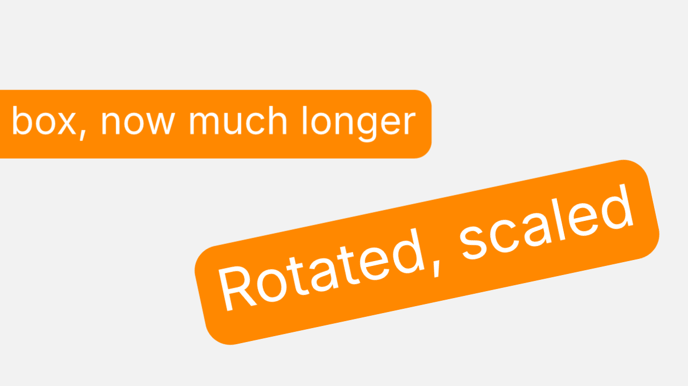

# TextBox

A ScriptUI panel that puts a rounded rectangle behind each selected text layer.

## Use

1. Select one or more text layers. Other selected layers are skipped.
2. Set the color (a hex value, or Random), the X and Y padding, and the roundness.
3. Click Create.

Each box is a shape layer named "<text layer> Box", placed directly below its text layer and parented to it. It copies the text layer's start, in and out points, and it is 3D when the text layer is.

## The box follows the text

Expressions size and center the rectangle from the text's `sourceRectAtTime` on every frame. Editing or animating the text, or moving, rotating or scaling the text layer, updates the box without running the panel again.

Padding X, Padding Y, Roundness and Color are expression controls on the box layer. Change them later in Effect Controls. Roundness is a percent of half the box's shorter side.

## Files

- `TextBox.jsx`: the panel.
- `test_textbox.jsx`: a headless self-check. It builds a comp, fills in the panel's fields, clicks Create, and checks the boxes' parenting, size, position, roundness, color, and that a box grows when its text gets longer.
- `preview.png`: a frame EffectCraft rendered from the test comp.

Tested with EffectCraft 0.14.0. This is an independent script written from scratch for EffectCraft. It is not affiliated with any After Effects script of the same name.
